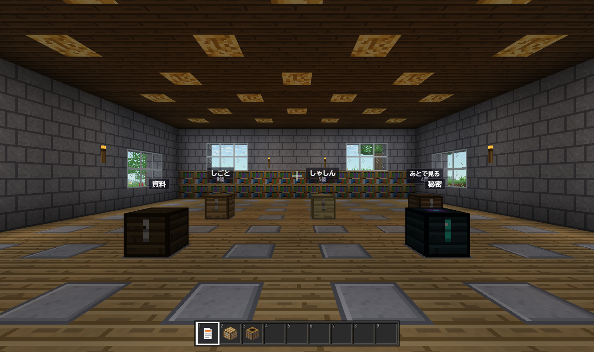
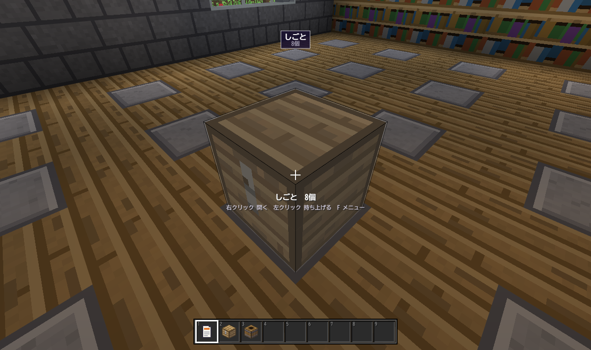
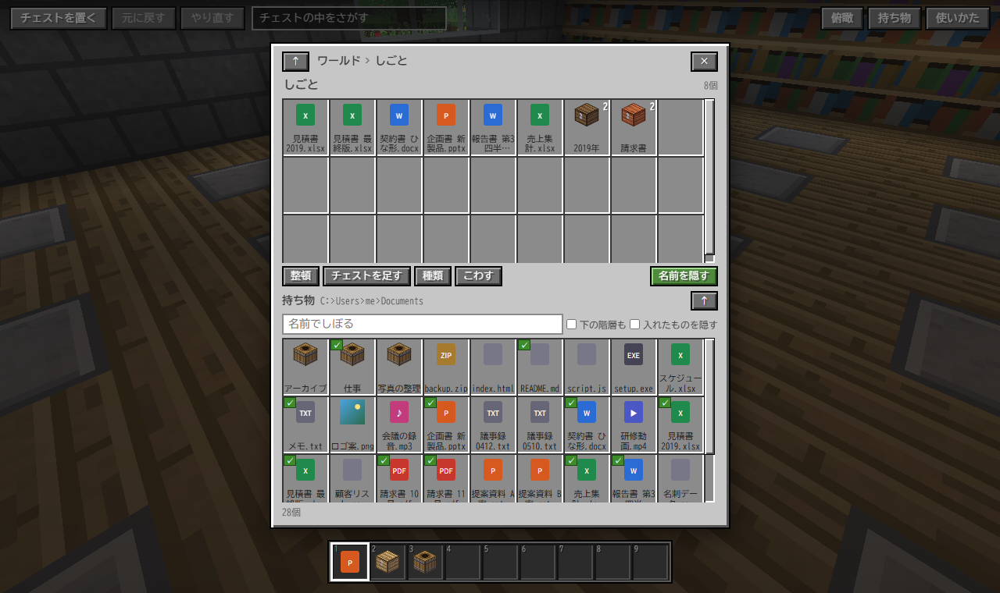

# チェスト・ファイラー

チェストがフォルダーのファイラーです。マイクラのようなワールドを歩いて、チェストを開き、ファイルを入れて整理します。

チェストは**仮想のフォルダー**です。ファイルを入れても、本物のファイルは動きません。通信はしません。

[explorer_plus](https://github.com/Neptunity-git/explorer_plus) の MOD です。`neo.chest-filer` 0.2.0。まだ 1.0 より前です。育てている途中なので、動きや保存の形が変わることがあります。







## できること

- ブロックでできたワールドを、一人称の 3D で歩きます。広間には台座が並び、台座の上にチェストが置かれています。
- チェストを右クリックで開き、ファイルを入れます。チェストの中に、別のチェストも入れられます。
- チェストに入るのは、本物のファイルへの「参照」です。ファイル ID で覚えるので、名前を変えても、移しても、外れません。
- 本物のファイルを変えるのは、本体のメニューで選んだときだけです。名前の変更・ごみ箱などです。
- 斜め上から見る「俯瞰」にも切りかえられます。WebGL2 が使えない環境では、俯瞰で始まります。

### 歩くときの操作

| 操作 | 動き |
|---|---|
| W A S D | 歩く。Ctrl か W を 2 回で走る |
| Space / Shift | ジャンプ / しゃがむ。Space を 2 回で飛ぶ |
| マウス | 見回す。ポインターを固定できない環境では、矢印キー |
| 右クリック | 狙ったチェストを開く。空いた台座には、新しいチェストを置く |
| 左クリック | 狙ったチェストを持ち上げる。台座や別のチェストへ右クリックで置く |
| F | 狙ったチェストのメニュー（名前・種類・こわす） |
| E | 持ち物だけを開く |
| 数字キー | ホットバー |
| / | 検索 |
| V | 歩くと俯瞰を行き来する |

## 入れ方

1. [Releases](https://github.com/Neo-Neptunity/chest-filer/releases) を開き、いちばん新しい版の zip（`neo.chest-filer-版.zip`）をダウンロードします。「Source code」ではなく、自分で付けた zip のほうです。
2. explorer_plus のホームの「MOD」の欄で「＋ MOD を入れる（zip）」を押して、zip を選びます。解凍はしません。
3. 確認の画面の「このビューが使う情報」を読んで、よければ入れます。

## 使う情報

| 使う情報 | 使いみち |
|---|---|
| `entries` | 今のフォルダの中身を、持ち物に出す |
| `size` `modified` | ファイルの大きさと更新日時を出す |
| `icons` `thumbnails` | Windows のアイコンと縮小画像を、スロットに出す |
| `links` | 保存したファイル ID から、今の場所を引く |
| `search` | 検索 |
| `pointerLock` | マウスで見回すために、ポインターを固定する |

## 設定

スロットの大きさ・ファイルの絵（Windows のアイコンと縮小画像 / ブロック風）・効果音・空（テーマに合わせる / 昼 / 夕方 / 夜）・視野の広さ・画質・俯瞰の部屋の松明。

## 作りかた

- [docs/design.md](docs/design.md)：設計書
- [dev/](dev/)：自動の試験と、画面を撮る道具。説明は [dev/README.md](dev/README.md)。そこに書かれたコマンドは、作者の置き場所から流す書き方です。このリポジトリでは、先頭の `chest-filer/` を外して読んでください。

```
node dev/unit.mjs
```

Node.js だけで動きます。`dev/browser.mjs` は Edge か Chrome が要ります。

## ライセンス

[MIT](LICENSE)
