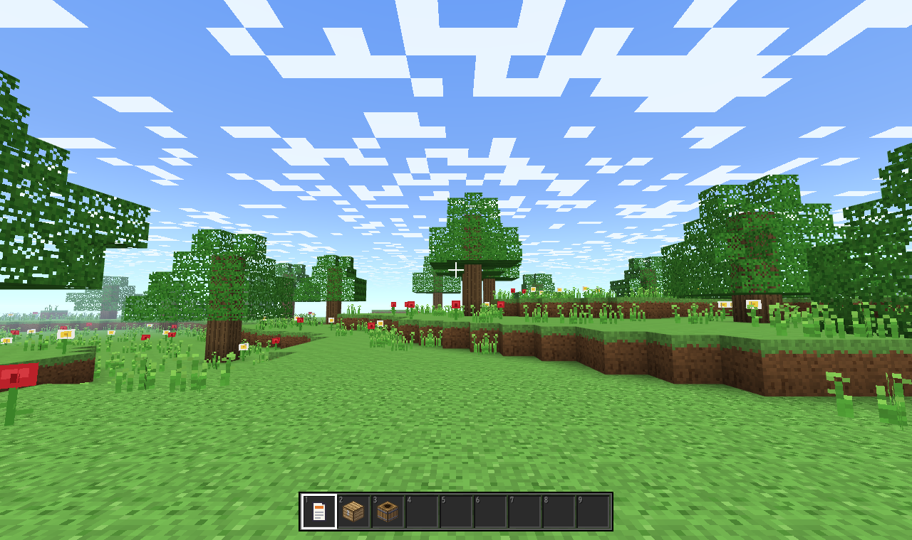
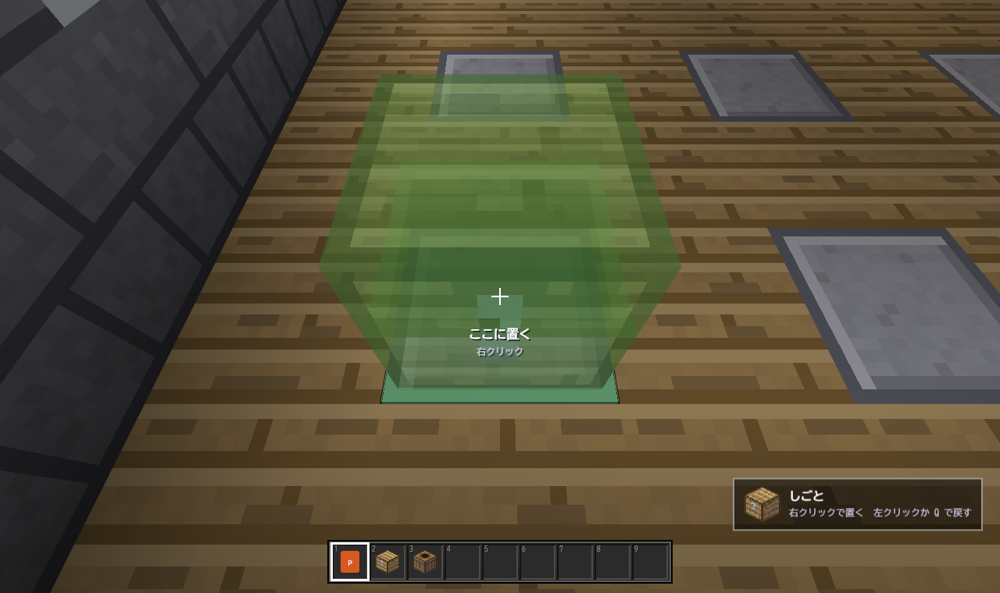

# チェスト・ファイラー 設計書

`neo.chest-filer` 0.2.0。チェストがフォルダーのファイラー。マイクラのようなワールドを歩いて、チェストを開き、ファイルを入れて整理する。
0.1.0（2026-10-27）で、チェストと仮想ディレクトリのしくみを作り、同じ日に 0.2.0 で、見た目を「ワールドの中を WASD で歩く」一人称の 3D に作り替えた。しくみ（仮想ディレクトリ・チェストの画面・保存・検索）は 0.1.0 のまま。実機（本物の explorer_plus）では未確認。


## 決めたこと

| 項目 | 決め |
|---|---|
| 仮想ディレクトリ | チェスト＝仮想のフォルダー。チェストの中にチェストを入れられる（深さの上限なし）。本物のファイルは動かさない |
| 入れるもの | 本物のファイル・フォルダへの「参照」。ファイル ID で覚えるので、名前を変えても移しても外れない（ID の無いドライブはパス） |
| 木の決まり | チェストは、ワールドの台座の上か、どれか1つのチェストのスロットに、ちょうど1回だけ置かれる |
| ファイルの置き場 | 同じファイルは、ふつう1つのチェストにだけ入る（持ち物から入れると、別のチェストからは移る）。Ctrl で落とすとコピー。同じチェストに同じものは2つ入らない |
| 持ち物 | 今開いている本物のフォルダの中身。本物のフォルダは樽の絵。ダブルクリックで、このタブがそのフォルダへ移る |
| 見かた | 歩く（一人称の 3D）が既定。俯瞰（斜め上から見る部屋）にも切りかえられる。どちらも同じデータを見る。WebGL2 が使えない環境では、俯瞰になる |
| 大きさ | チェストのスロットは足りなくなると行が増える。上限は 1350 個（150 行）。保存の1つの値 1MB に収まる |
| 本物のファイルを変えるとき | 本体のメニューで利用者が選んだときだけ（名前の変更・ごみ箱・タグなど）。名前の変更は `onAction` の合図を受けて、名前を聞いて `ep.rename`。ほかには何も変えない |
| 通信 | しない |

## 歩く（一人称の 3D）

マイクラのように、ブロックでできたワールドを歩く。画像ファイルは使わず、ブロックの絵（16 ピクセル）も全部コードで描く。




- **ワールド**：128 × 32 × 128 ブロック。広間（中が 17 × 17）が真ん中にあり、石レンガの壁・本棚・ガラスの窓・天井の光るブロック・壁のたいまつ。床に台座が 8 × 8 個並び、チェストは台座の上に立つ。南の入口から道が草原へ続き、まわりに木・草・花・小さな丘。空には四角い太陽と月・星・ブロックの雲。昼と夜は、テーマに合わせる（設定で、昼・夕方・夜に決められる）
- **光**：空の光とたいまつの光を、マイクラと同じく 1 ブロックごとに 1 ずつ弱くして、頂点ごとになめらかに混ぜる。夜は空の光だけが弱くなり、広間の明かりはそのまま
- **歩く**：W A S D、Space でジャンプ、Shift でしゃがむ、Ctrl か W を2回で走る、Space を2回で飛ぶ。体は幅 0.6・高さ 1.8、ジャンプは 1.25 ブロック。チェストにはぶつかる
- **見回す**：ポインターを固定して（`pointerLock`）、マウスの動きで向きを変える。固定できない環境では、矢印キーで見回す。Esc で固定が外れて、クリックを待つ画面になる
- **狙う**：目の前 5.5 ブロックまで。狙ったチェストは枠が出て、名前と操作のヒントが出る。台座を狙うと、緑の枠
- **開く**：右クリックで、チェストの画面（0.1.0 と同じ）。マイクラと同じく、ワールドの上に、画面の中央で重なり、うしろは少し暗くなる。**カメラ（ワールドの見え方）は動かさない**。開いているあいだは歩けず、ポインターは戻る。画面のまわりに見えているチェストは、クリックで切りかわり、ファイルを直接ドロップできる。何も無い所をクリックか Esc で閉じて、また歩ける
- **動かす**：左クリックでチェストを持ち上げる（画面の右下に出る）。台座へ右クリックで置く。別のチェストへ右クリックで、その中へ入れる。もう一度左クリックか Q で、元に戻す
- **置く**：空いた台座へ右クリック（手が空のとき）で、新しいチェスト。名前をすぐ入れられる
- **メニュー**：F で、狙ったチェストのメニュー（名前・種類・こわす）
- **名札**：近いチェストの上に、名前と中の数。壁のむこうは出さない
- **ほか**：E で持ち物だけ。数字キーでホットバー（チェストなら、その場で開く）。/ で検索（見つけたら、その場でそのチェストを開く。歩く人は動かさない）。R ではじまりの場所へ。V で俯瞰へ

## 画面（チェストの画面・ホットバー）

- チェストの画面（ワールドの上に、中央で重ねる。うしろは少し暗くする。俯瞰でも同じ）：見出し（ワールド › しごと › 2019年。それぞれ押せて、落とす先にもなる）・名前（その場で直せる）・スロット・整頓・チェストを足す・種類・こわす・名前の出し入れ
- 持ち物：下の階層も・入れたものを隠す・名前でしぼる。場所の見出しの各階層が押せる
- ホットバー：9つ。ファイル・フォルダ・チェストへの近道
- ふきだし：名前・種類・大きさ・更新日・パス・入っているチェスト
- 画面の左下に、マイクラのチャットのように、何をしたかが出る。文章は短く言い切り、括弧の補足は付けない

## 操作（チェストの画面）

| 操作 | 結果 |
|---|---|
| ドラッグ（持ち物 → スロット） | 参照を入れる |
| ドラッグ（スロット → チェストの絵の上） | そのチェストの中へ |
| ドラッグ（スロット → 中身のあるスロット） | 場所を入れかえる |
| ドラッグ（スロット → 見出しの「ワールド」） | チェストは台座の空きへ出る |
| ドラッグ（スロット → 持ち物） | チェストから出す。チェストは台座の空きへ |
| ドラッグ（スロット → ワールドに見えているチェスト） | そのチェストの中へ |
| Ctrl+クリック・Ctrl+A | 複数選ぶ・全部選ぶ |
| Shift+クリック | 持ち物なら開いているチェストへ。チェストの中なら出す |
| Ctrl を押して落とす | コピー（チェストは移る） |
| ダブルクリック・Enter | チェストなら中へ。ファイルなら本物のアプリで。フォルダならそのフォルダへ |
| 数字 1〜9 | スロットの上ならホットバーに登録。それ以外はホットバーを開く |
| Delete | 選んだものをチェストから出す |
| Esc | ひとつ上のチェストへ。いちばん上なら閉じる |
| F2 | チェストの名前を直す。持ち物のファイルを1つ選んでいれば、その名前の変更 |
| Ctrl+Z・Ctrl+Y | 元に戻す・やり直す（100 回まで） |

ドラッグは、押して 5 ピクセル動いたら始まる。ウィンドウの外でボタンを離したときは、ドラッグをやめる。

## 作り

```
mod/
  consts.js    数と種類（チェストの木の種類・整頓の並べかた）
  model.js     仮想ディレクトリの本体。画面にも本体にも触れない
  persist.js   保存。meta とチェスト1つずつに分けて ep.storage へ
  index.js     つなぎ。本体とのやりとり。見かた（歩く・俯瞰）の切りかえ
  gui.js       チェストの画面・ドラッグ・ふきだし・検索の結果
  grid.js      見えている行だけを DOM にするグリッド
  — 歩く（3D） —
  blocks.js    ブロックの種類と、絵の層の名前
  terrain.js   地形（広間・台座・窓・たいまつ・草原・木）
  light.js     光の広がり
  mesher.js    ブロックの面を三角形に。スムースライティング。チェストの形
  physics.js   歩く・ぶつかる・見ている先をさがす（レイ）
  blocktex.js  ブロックの絵を全部コードで描く
  gl.js        シェーダー（地形・空・線）・行列・見える範囲
  world3d.js   描画・歩く操作・狙う・持ち上げる・名札・ポーズの画面
  — 俯瞰 —
  iso.js       斜め上から見た絵の部品
  room.js      俯瞰の描画と操作
  textures.js  木・石・チェスト・樽の模様（俯瞰と、3D のチェストの絵が使う）
  — 共通 —
  sprites.js   ファイルの絵（紙・表・画像・円盤・フィルム・箱・歯車・コード）
  audio.js     WebAudio の小さな効果音（足音もある）
  text.js      大きさ・日付の整え
  style.css
```

3D の部品のうち、`blocks`・`terrain`・`light`・`mesher`・`physics` は画面に触れないので、node で試験できる。`blocktex`・`gl`・`world3d` が WebGL2 と DOM を使う。

### model.js

- チェスト・部屋・ホットバーの配列は「作り直す」だけで、中を書き換えない。元に戻す記録は参照を持つだけで済み、保存のときは `===` で変わったチェストが分かる
- `run(label, fn)` で包んだ変更だけが、元に戻す記録に残る。何も変わらなければ残さない
- `dropHand(hand, target)` が、ドラッグの置きかたをすべて決める。置く前に空きを数え、足りない分は元の場所に残す
- チェストは持ち物にならない。持ち物の所へ落とすと、台座の空きへ出る
- `check()` が木の決まりを調べる。試験が、乱数の操作 4000 回のあいだ呼び続ける
- 部屋の升は 8 × 8。3D では、升 (x, y) の台座が 広間の (1 + 2x, 1 + 2y) のブロックになる

### 3D の描きかた

- WebGL2。絵は 1 枚の「テクスチャ配列」（1 層が 16 × 16。ブロック 20 種類＋チェスト 10 種類 × 6 面）。遠くでは mip で、近くは NEAREST でくっきり
- 区画（16 × 16 の柱）ごとに面を作り、見える範囲だけ描く。作るのは 1 コマに 6ms まで。入口に近い区画から
- 頂点：位置・絵の座標・層・光（空・たいまつ・かげ・向き）。四角の分けかたは、かげの出かたで裏返す
- チェストは動くので別に描く。体とふたの 2 つの箱で、ふたは後ろのふちを軸に 78 度まで開く。向きはいつも南。光は、その升の光
- 空は、画面いっぱいの 1 枚の三角形に、方向から色を求める。四角い太陽と月、星、雲
- 狙いの枠は、線とうすい面。名札は、別の 2D の canvas に描く（壁のむこうは、光線で調べて出さない）
- チェストの画面は、ワールドに重ねるだけで、カメラは動かさない。投影を横にずらす仕組み（`setInset`）は残してあるが、今は使っていない

### 保存

`ep.storage` に、`w`（meta：部屋の位置・ホットバー・チェストの一覧）、`c.<id>`（チェスト1つ）、`prefs`（見せかた・見かた（歩く・俯瞰）・向き・拡大）。書く順はチェスト → meta。途中で止まっても、meta が無いチェストを指すことは無い。読み込みは、壊れていても読めるところだけで木を作る（部屋につながらないチェストは捨てる）。ワールドの地形は保存しない（いつも同じ形を作る）。歩く位置も保存しない（はじまりの場所から）。

### 本体の API

使うのは `onFolder`・`resolve`・`open`・`navigate`・`navigateUp`・`search.find`・`showMenu`・`onAction`・`rename`（メニューで選ばれたときだけ）・`storage`・`settings`・`commands`・`ui.confirm/ask/choose`、それに標準の `requestPointerLock`。`uses` は entries・size・modified・icons・thumbnails・links・search・pointerLock。

本体は、ポインターを固定しているあいだ、Ctrl や Alt を押したキーを本体のショートカットにしない（Ctrl+W でタブが閉じない）。固定していないときは、Ctrl での走りは使わない。本体が確かめや右クリックのメニューを出すときは、ポインターを外す。

`showMenu` の本体の項目は、今のタブのフォルダの外のファイルでは一部が使えない（名前の変更・「プログラムから開く」）。そのときは、このビューの項目とほかの項目だけが出る。

## 試験

`dev/README.md`。`unit.mjs` は node だけ（516 件）。`browser.mjs` は偽の本体で本物の `index.js` を動かす（歩く場面の試験は `walk-scenarios.mjs`）。

## まだ確かめていないこと

- 本物の explorer_plus の中での動き。ポインターの固定の手触り・マウスの感度・キーが届くか・本体のメニューの出かた・アイコンと縮小画像の見え方・`resolve` の速さ（チェスト 1350 個のとき）
- 本物の GPU での速さ。試験はソフトウェア描画
- 画面の押し出しが小さいウィンドウで窮屈でないか

## 次の候補

- 水・階段・ドア・看板など、ブロックを増やす。チェストの前に、名前の看板
- チェストを開くとき、中のファイルが光の粒で飛び出す
- チェストの書き出し・読み込み（JSON を `.json` で。`createFiles` が要る）
- チェストを OneDrive などで共有（`folderData` に保存して同期）
- 本物のフォルダを、チェストとして開く（エンダーチェスト）
- 広間をふやす・広間のつくりを選ぶ
- 実際にファイルを動かす「整理」（今は仮想だけ）
